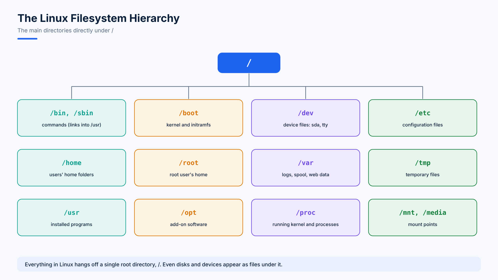

# 03. Navigating the File System

A **file system** is how an operating system organizes files. Linux has **one tree** that starts at the root directory `/`. There are no drive letters like `C:` or `D:`: extra disks are attached (mounted) somewhere inside the tree.



## Where Am I, and How Do I Move?

```bash
pwd          # print working directory: where you are
cd /         # go to the root directory
cd ~         # go to your home directory (cd alone does the same)
cd ..        # go up one level, to the parent directory
cd -         # go back to the previous directory
```

## Absolute and Relative Paths

A **path** is a file's address in the directory tree.

| Type | Starts with | Example | Meaning |
|---|---|---|---|
| **Absolute** | `/` | `/home/ahmad/notes.txt` | The full address from the root. Works from anywhere |
| **Relative** | anything else | `notes.txt`, `../projects` | Relative to where you are now |

Every directory contains two special entries:

| Entry | Meaning | Example |
|---|---|---|
| `.` | The current directory | `./script.sh` runs a script in this folder |
| `..` | The parent directory | `cd ../..` goes up two levels |

## Listing Files with ls

| Command | Shows |
|---|---|
| `ls` | Names of files and directories |
| `ls -l` | Long format: permissions, owner, size, date |
| `ls -a` | All files, including hidden ones (names starting with `.`) |
| `ls -A` | All files except `.` and `..` |
| `ls -lh` | Sizes in KB, MB, GB instead of bytes |
| `ls -lt` | Newest first |
| `ls -lt --reverse` (or `ls -ltr`) | Oldest first |
| `ls -lr` | Reverse alphabetical order |
| `ls -S` | Largest first |
| `ls -li` | The inode number of each file |
| `ls -F` | Adds `/` to directories, `*` to executables, `@` to symbolic links |
| `ls -d */` | Only directories |
| `ls -ld /etc` | Details of the directory itself, not its contents |

Options combine: `ls -lah` is a favourite.

## Quick Practice

```bash
cd /usr/share     # absolute path
ls -F | head      # what is here?
cd ../bin         # relative path: from /usr/share up to /usr, then into bin
pwd               # /usr/bin
cd ~              # home again
```
