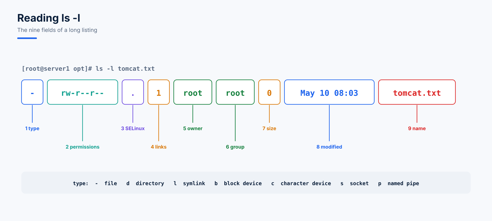

# 03. Reading ls -l and File Types

## The Nine Properties of ls -l



```text
[root@server1 opt]# ls -l tomcat.txt
-rw-r--r--. 1 root root 0 May 10 08:03 tomcat.txt
```

| # | Property | Value here |
|---|---|---|
| 1 | File type | `-` regular file |
| 2 | Permissions | `rw-r--r--` |
| 3 | SELinux context marker | `.` (use `ls -Z` to see the context itself) |
| 4 | Link count | `1` |
| 5 | Owner | `root` |
| 6 | Group | `root` |
| 7 | Size in bytes | `0` |
| 8 | Last **modification** time | `May 10 08:03` (use `ls -lu` for access time) |
| 9 | File name | `tomcat.txt` |

## The Seven File Types

| Symbol | Type | Example |
|---|---|---|
| `-` | Regular file | `/etc/passwd` |
| `d` | Directory | `/etc` |
| `l` | Symbolic link | `/bin -> usr/bin` |
| `b` | Block device (data in blocks: disks) | `/dev/sda` |
| `c` | Character device (data one character at a time) | `/dev/tty1`, `/dev/null` |
| `s` | Socket (communication between processes) | `/run/systemd/notify` |
| `p` | Named pipe (FIFO) | created with `mkfifo` |

```bash
ls -l /dev/sda /dev/tty1 /bin    # b, c and l in one listing
file /etc/passwd                 # describes any file's content type
```

## The . and .. Directories

```text
[root@server1 opt]# cd country/
[root@server1 country]# ls -a
.  ..  africa  china  US
```

| Entry | Means | So `cd` to it... |
|---|---|---|
| `.` | The current directory | stays where you are |
| `..` | The parent directory | goes up one level |

They are hard links, which is why a new directory starts with a link count of 2 (its name in the parent, plus its own `.`).

## Questions

1. What type is `/dev/sdb1`, and why?
2. In `drwxr-xr-x. 5 ahmad devops 4096 Jan 2 10:15 projects`, who owns it and which group can enter it?

<details>
<summary>Answers</summary>

1. `b`, a block device: disks and partitions transfer data in blocks.
2. Owner `ahmad`; the `devops` group has `r-x`, so its members can list and enter it.
</details>
