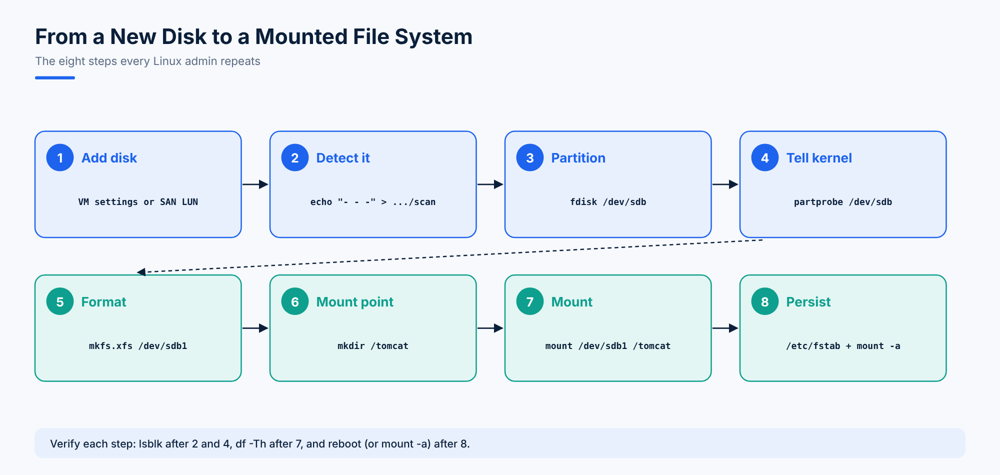

# 07. Disks and Partitions with fdisk



## Storage Types

| Type | What it is |
|---|---|
| **SATA HDD** | A spinning magnetic disk: a read/write head on an arm moves across spinning platters, so access takes a little time |
| **SSD** | Flash chips with no moving parts: much faster and more durable |
| **SAS** | Enterprise-grade disks with a faster, more reliable interface |
| **USB / pen drive** | Hot-plug flash storage |
| **NAS** | Network Attached Storage: a box of disks shared over the network as files (NFS, SMB) |
| **SAN** | Storage Area Network: a pool of disks presented to servers as block devices (LUNs) over Fibre Channel or iSCSI |

## How Linux Names Disks

Disks appear as **device files** in `/dev`. The kernel's drivers talk to the hardware; the device files are how you address it.

| Device file | Means |
|---|---|
| `/dev/sda` | The first SCSI/SATA/SAS/USB disk |
| `/dev/sdb` | The second disk |
| `/dev/sda1`, `/dev/sda2` | Partitions 1 and 2 on the first disk |
| `/dev/nvme0n1`, `/dev/nvme0n1p1` | First NVMe SSD, and its first partition |
| `/dev/vda` | A virtual disk in KVM virtual machines |

A disk with 4 partitions therefore has **5 device files**: `sda`, `sda1`, `sda2`, `sda3`, `sda4`.

```bash
lsblk               # disks and partitions as a tree (the go-to command)
ls /dev/sd*         # the device files
fdisk -l            # every disk with its partitions and sizes
```

## Partition Tables: MBR and GPT

| | MBR (msdos) | GPT |
|---|---|---|
| Age | Old (1983) | Modern, part of UEFI |
| Max disk size | 2 TB | 8 ZB (effectively unlimited) |
| Partitions | 4 primary, or 3 primary + 1 extended holding logical partitions | 128 by default, all primary |
| Tools | `fdisk` | `fdisk` (newer versions), `gdisk`, `parted` |

```bash
parted /dev/sda print     # shows "Partition Table: msdos" or "gpt"
```

### Primary, Extended and Logical Partitions (MBR)

- One disk can hold at most **4 primary** partitions.
- For more, make the 4th one an **extended** partition: a container for **logical** partitions.
- Numbers 1 to 4 are always primary or extended; logical partitions start at **5**.

A common layout: partitions 1 to 3 primary, 4 extended, 5 onwards logical. For Linux, primary and logical partitions work exactly the same.

## Detecting a New Disk Without Rebooting

A disk added while the machine is off is detected at boot. In production, disks (often **LUNs** from a SAN) are added to running servers, so tell the kernel to rescan each SCSI host adapter:

```bash
ls /sys/class/scsi_host/                       # host0, host1, host2 ...
echo "- - -" > /sys/class/scsi_host/host0/scan
echo "- - -" > /sys/class/scsi_host/host1/scan
echo "- - -" > /sys/class/scsi_host/host2/scan
lsblk                                          # the new disk appears, e.g. sdb
```

The three dashes are wildcards for the **channel, target ID and LUN**, meaning "scan everything". Run it once per host adapter (port).

### SAN Vocabulary

| Term | Meaning |
|---|---|
| **LUN** | Logical Unit Number: one disk carved out of the SAN and given to a server |
| **HBA** | Host Bus Adapter: the card that connects a server to the SAN with Fibre Channel cables |
| **Target** | The SAN storage system |
| **Initiator** | The server that uses the storage |

## Creating a Partition with fdisk

**Task:** create a 700 MB partition on a new 800 MB disk, `/dev/sdb`.

```bash
fdisk -l /dev/sdb      # check the size
fdisk /dev/sdb         # open the disk
```

Inside fdisk:

| Key | Action |
|---|---|
| `m` | Help |
| `n` | New partition |
| `p` | Primary (then partition number `1`, Enter for the default first sector) |
| `+700M` | Size |
| `t` | Change the type (for example `8e` for LVM, `82` for swap) |
| `p` | Print the table to check |
| `d` | Delete a partition |
| `w` | **Write** the changes and exit |
| `q` | Quit without saving |

Pressing `w` updates the **partition table on the disk**. The kernel keeps its own copy in memory, so update that too:

```bash
partprobe /dev/sdb     # RHEL 7 and later
partx -a /dev/sdb      # older alternative
lsblk                  # sdb1 now appears
```

The partition is ready, but you can't store files on it until it has a **file system** (topic 08).

> ⚠️ A corrupted partition table can stop a machine from booting. Double-check the disk name (`sdb`, not `sda`) before pressing `w`.

## Good to Know

- **Why is my 500 GB disk only 465 GB?** Manufacturers count 1 GB as 1000³ bytes; Linux tools count 1 GiB as 1024³ bytes. The space is the same, only the unit differs.
- **`sync`** flushes data still waiting in memory to the disks. Run it before removing a USB drive or after heavy disk work.

## Questions

1. A disk has 6 partitions. How many device files, file systems and partition tables does it have?
2. You need 8 partitions on an MBR disk. How do you arrange them?
3. A 3 TB disk is added to a server. Which partition table must you use?
4. A new LUN was presented to a running server but `lsblk` doesn't show it. What do you run?

<details>
<summary>Answers</summary>

1. 7 device files (the disk plus 6 partitions), 6 file systems (one per partition) and 1 partition table.
2. 3 primary, 1 extended, and 5 logical partitions (numbered 5 to 9) inside the extended one.
3. GPT, since MBR can't address more than 2 TB.
4. `echo "- - -" > /sys/class/scsi_host/hostN/scan` for each host adapter, then `lsblk`.
</details>
