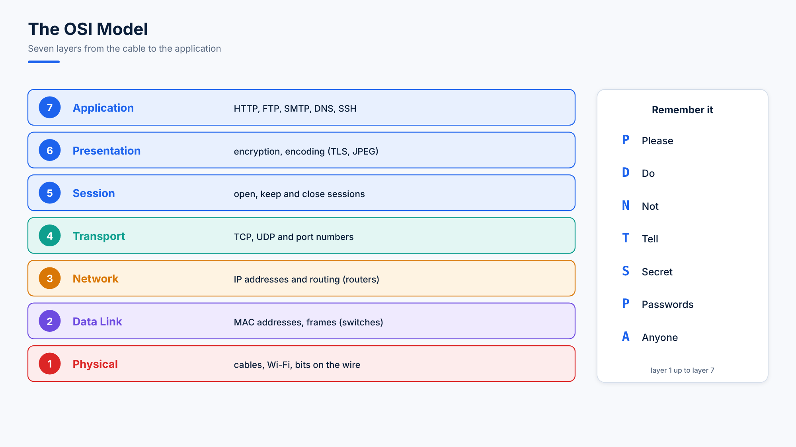

# 03. Protocols, Ports and the OSI Model

## Protocols

A **protocol** is a set of rules for how data travels over a network: the language two computers agree to speak.

| Protocol | Purpose |
|---|---|
| **HTTP / HTTPS** | Web pages; HTTPS is the encrypted version (online banking, any modern site) |
| **FTP** | File transfer |
| **SSH** | Secure remote login |
| **TCP** | Reliable delivery: checks every piece arrives, in order |
| **UDP** | Fast delivery without those checks (video calls, gaming, DNS lookups) |
| **DNS** | Names to IP addresses |
| **DHCP** | Hands out IP addresses automatically |
| **NFS** | Network file sharing between Linux systems |
| **SMB** | Windows file sharing (Samba on Linux) |
| **ICMP** | Network diagnostics (`ping`) |

## Ports

A **port** is a numbered door on a machine. One server can run many services, and each listens on its own port, so incoming data reaches the right program.

| Port | Service | Port | Service |
|---|---|---|---|
| 20, 21 | FTP (data, control) | 389 | LDAP |
| 22 | SSH (and SFTP, SCP) | 443 | HTTPS |
| 23 | Telnet (unencrypted, avoid) | 445 | SMB (Samba) |
| 25 | SMTP (sending mail) | 993 | IMAPS |
| 53 | DNS | 995 | POP3S |
| 67, 68 | DHCP | 2049 | NFS |
| 80 | HTTP | 3128 | Squid proxy |
| 110 | POP3 | 3306 | MySQL / MariaDB |
| 137 to 139 | NetBIOS (Samba) | 3389 | RDP (Windows remote desktop) |
| 143 | IMAP | 8080 | Tomcat, alternative HTTP |

| Range | Name |
|---|---|
| 0 to 1023 | **Privileged** (well-known) ports: only root can listen on them |
| 1024 to 65535 | **Unprivileged** ports: registered services, and random source ports for outgoing connections |

The full list of names and numbers is in `/etc/services`:

```bash
less /etc/services
grep -w 22 /etc/services
```

### Ports and Services

- A port is **open** when a service is listening on it: start the service and its port opens; stop it and the port closes.
- You can move a service to another port in its configuration file (for example `Port 2222` in `/etc/ssh/sshd_config`). Clients must then be told to connect to the new port (`ssh -p 2222 server`), because they assume the standard one.

## The OSI Model

The **OSI model** (Open Systems Interconnection) describes networking in seven layers. Each layer has one job and relies on the layer below.



| # | Layer | Job | Examples |
|---|---|---|---|
| 7 | **Application** | Network services for programs and users | HTTP, FTP, SMTP, DNS, SSH |
| 6 | **Presentation** | Translating, encrypting, compressing data | TLS encryption, JPEG |
| 5 | **Session** | Opening, keeping and closing conversations | |
| 4 | **Transport** | Reliable (TCP) or fast (UDP) delivery, using **ports** | TCP, UDP |
| 3 | **Network** | Routing between networks, using **IP addresses** | IP, ICMP, routers |
| 2 | **Data Link** | Delivery on the local network, using **MAC addresses** | Ethernet, switches |
| 1 | **Physical** | Raw bits over the medium | Cables, Wi-Fi, fibre |

**Memory trick** (layer 1 up to 7): **P**lease **D**o **N**ot **T**ell **S**ecret **P**asswords **A**nyone.

**Analogy:** sending a letter. You write it (Application), put it in an envelope (Presentation, Session), address it (Transport, Network), and hand it to the postal service that physically carries it (Data Link, Physical).

## Machine vs Server

- A **machine** is any computer, physical or virtual: your laptop, a VM, a box in a data centre.
- A **server** is a machine whose job is to provide services to other machines (**clients**): websites, files, databases, email.

Every server is a machine, but a machine only becomes a server when it is set up to serve others.

## Questions

1. Which layer does a switch work at, and which address does it use?
2. Why can't a normal user start a web server on port 80?
3. A developer moved MySQL from 3306 to 3307. What must the applications change?

<details>
<summary>Answers</summary>

1. Layer 2 (Data Link), using MAC addresses.
2. Ports below 1024 are privileged: only root (or a process given that capability) can listen on them.
3. Their connection settings must use port 3307, and the firewall (and SELinux port label) must allow it.
</details>
