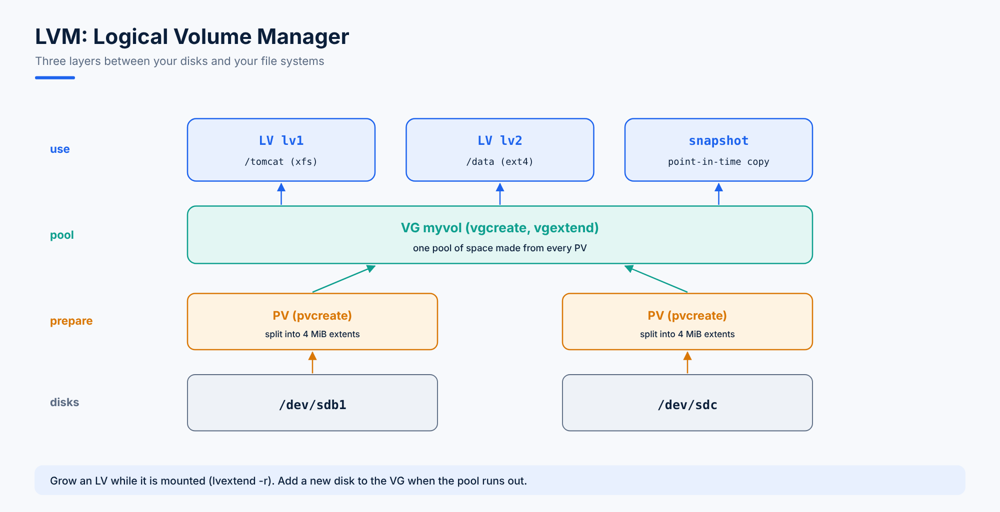

# 09. LVM - Logical Volume Manager

**LVM** adds a flexible layer on top of ordinary partitions. Instead of a fixed partition per mount point, you pool disks together and carve out volumes that can **grow, shrink, span several disks and take snapshots**, often without downtime.



## The Three Layers

| Layer | Command | Is |
|---|---|---|
| **PV** Physical Volume | `pvcreate` | A disk or partition prepared for LVM |
| **VG** Volume Group | `vgcreate` | A pool of space made from one or more PVs |
| **LV** Logical Volume | `lvcreate` | A "virtual partition" taken from the VG, which you format and mount |

A single VG can hold many PVs and many LVs.

## Create an LVM Volume

1. Add a disk (shut the VM down, or rescan with `echo "- - -" > /sys/class/scsi_host/host0/scan`).
2. Create a partition with `fdisk`, and press `t` to set its type to **`8e`** (Linux LVM) instead of `83` (Linux). A whole disk can also be used as a PV without partitioning.
3. Build the layers:

```bash
partprobe -s /dev/sdb
pvcreate /dev/sdb1                  # 1. physical volume
vgcreate myvol /dev/sdb1            # 2. volume group named myvol
lvcreate -L 500M -n lv1 myvol       # 3. a 500 MB logical volume named lv1
mkfs.xfs /dev/myvol/lv1             # format it
mkdir /tomcat
mount /dev/myvol/lv1 /tomcat
df -h
```

The LV appears as `/dev/myvol/lv1` (also `/dev/mapper/myvol-lv1`). Add it to `/etc/fstab` to mount it at every boot.

## Inspect

| Short summary | Detailed | Rescan |
|---|---|---|
| `pvs` | `pvdisplay` | `pvscan` |
| `vgs` | `vgdisplay` | `vgscan` |
| `lvs` | `lvdisplay` | `lvscan` |

```bash
lsblk                   # the go-to view of disks, partitions and LVs
lvs -o +devices         # which PVs each LV lives on
lvmdiskscan             # every device LVM can use
```

## Extend an LV

Example: `/dev/sdb1` is 700 MB and `lv1` uses 500 MB of it. Grow `lv1`:

```bash
lvextend -L +100M /dev/myvol/lv1    # add 100 MB
lvextend -L 600M /dev/myvol/lv1     # or set the total size to 600 MB
lvextend -l +100%FREE /dev/myvol/lv1   # or take all free space in the VG
```

Then grow the **file system** to fill the bigger volume, while it stays mounted:

```bash
xfs_growfs /tomcat                  # XFS (takes the mount point)
resize2fs /dev/myvol/lv1            # ext4
```

> 💡 `lvextend -r` resizes the file system in the same step: `lvextend -r -L +100M /dev/myvol/lv1`.

## When the VG Is Full: Add More Space

### From the Rest of the Same Disk

`sdb` is 1 GB but `sdb1` is only 700 MB. Create `sdb2` from the remaining 300 MB:

```bash
fdisk /dev/sdb                      # new partition sdb2, type 8e
partprobe -s /dev/sdb
pvcreate /dev/sdb2
vgextend myvol /dev/sdb2            # add it to the pool
lvextend -r -l +100%FREE /dev/myvol/lv1
```

### From a New Disk

Grow `lv1` to 2 GB although `sdb` is only 1 GB, by adding a second 1 GB disk `sdc`:

```bash
pvcreate /dev/sdc
vgextend myvol /dev/sdc
lvextend -r -l +100%FREE /dev/myvol/lv1
```

Now `lv1` spans both `sdb` and `sdc`. The reverse also works: one disk can hold parts of several LVs (`lv1`, `lv2`). As long as the VG has free space, you can create more LVs from it:

```bash
lvcreate -L 300M -n lv2 myvol
```

If the VG has no free space and no new disk is available, shrink another LV (ext4 only) and give its space to the one that needs it.

## Reduce an LV (ext4 Only)

**XFS can't be shrunk.** Only ext4 (and ext2/3) can. Back up first: if you shrink below the space actually used, data is lost.

```bash
umount /data
e2fsck -f /dev/myvol/lv2            # check the file system first (required)
resize2fs /dev/myvol/lv2 300M       # shrink the file system FIRST
lvreduce -L 300M /dev/myvol/lv2     # then shrink the LV to the same size
mount /data
```

`lvreduce -r -L 300M /dev/myvol/lv2` does the file system and LV steps together and is safer.

> ⚠️ Never run `mkfs` on a volume to "convert" it before resizing: that erases the data.

## Remove LVM

```bash
umount /tomcat                      # and remove its /etc/fstab line
lvremove /dev/myvol/lv1
vgremove myvol
pvremove /dev/sdb1
fdisk /dev/sdb                      # d to delete the partition, then w
```

## Snapshots

An **LVM snapshot** freezes a volume at a moment in time. It doesn't copy everything at once; it stores only the blocks that change afterwards, so it starts small and grows as the original changes. Use it for consistent backups or before risky changes.

```bash
lvcreate -L 200M -s -n lv1_snap /dev/myvol/lv1   # -s = snapshot
lvs                                              # Data% shows how full the snapshot is
mount -o ro,nouuid /dev/myvol/lv1_snap /mnt      # browse it (nouuid is needed for XFS)
lvconvert --merge /dev/myvol/lv1_snap            # roll the original back to the snapshot
lvremove /dev/myvol/lv1_snap                     # or discard it
```

If a snapshot fills up completely, it becomes invalid, so give it enough space.

## Physical Extents (PE)

A PV is divided into equal chunks called **physical extents**, the smallest unit LVM allocates. The default PE size is **4 MiB**, and every LV is a whole number of extents.

```bash
lvcreate -l 25 -n lv3 myvol         # lowercase -l: 25 extents x 4 MiB = 100 MiB
vgcreate -s 16M bigvol /dev/sdd     # a VG with 16 MiB extents (set at creation only)
vgdisplay myvol | grep "PE Size"
```

Smaller extents give finer control over sizes; larger ones mean less metadata for very large volumes. The default suits almost everyone.

## LVM Metadata and Configuration

LVM stores its own metadata on every PV, and the `pvs`/`vgs`/`lvs` commands read from it. Back it up:

```bash
vgcfgbackup myvol                   # written to /etc/lvm/backup/myvol
vgcfgrestore myvol                  # restore the structure from that backup
ls /etc/lvm/archive/                # automatic copies before every change
```

The main configuration file is **`/etc/lvm/lvm.conf`**. For example, its `filter` (or `global_filter`) setting stops LVM from ever using a particular disk.

## Questions

1. `/tomcat` (XFS on `/dev/myvol/lv1`) is full. The VG has 2 GB free. Grow it by 1 GB without downtime.
2. Why must `resize2fs` run before `lvreduce` when shrinking?
3. The VG has no free space. A new disk `/dev/sdd` was added. What are the steps?

<details>
<summary>Answers</summary>

1. `lvextend -r -L +1G /dev/myvol/lv1` (or `lvextend -L +1G` then `xfs_growfs /tomcat`).
2. If the volume shrinks first, the end of the file system is cut off and data is lost.
3. `pvcreate /dev/sdd`, `vgextend myvol /dev/sdd`, then `lvextend -r` on the LV.
</details>
