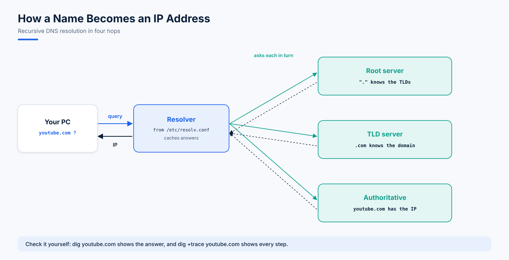

# 07. DNS with BIND

**DNS** (Domain Name System) does **name to IP resolution**: it turns `youtube.com` into an address your computer can connect to. RHEL's DNS server is **BIND**, whose daemon is called **named**. DNS uses port **53** (UDP for normal queries, TCP for large answers and zone transfers).



## How a Lookup Works

When you type `youtube.com`:

1. Your computer asks its **resolver** (the DNS server in `/etc/resolv.conf`).
2. If the answer isn't cached, the resolver asks a **root server**, which knows where the **top-level domain** (TLD) servers are, for `.com`, `.org`, `.net` and so on.
3. The **`.com` TLD server** points to the **authoritative server** for `youtube.com`.
4. The **authoritative server** returns the IP address.
5. The resolver caches the answer and gives it to your computer, which connects to YouTube.

### The Trailing Dot

The root of the DNS tree is written as a single dot. `youtube.com.` (with the final dot) is a **fully qualified domain name** (FQDN), and resolution starts at the root. Browsers add the dot for you, but in zone files it matters: a name **without** the dot gets the zone name appended.

## Lab 1: A Caching DNS Server

A caching server answers clients by doing the lookups above and remembering the results.

```bash
dnf install bind bind-utils bind-chroot -y
```

The main configuration is **`/etc/named.conf`**. By default BIND only answers the machine itself; to serve your network, edit these lines in the `options` block:

```text
listen-on port 53 { 127.0.0.1; 192.168.56.10; };
allow-query     { localhost; 192.168.56.0/24; };
recursion yes;
```

Check the syntax, start the service and open the firewall:

```bash
named-checkconf
systemctl enable --now named-chroot     # or "named" without the chroot jail
ss -tulnp | grep :53
firewall-cmd --permanent --add-service=dns && firewall-cmd --reload
```

`named-chroot` runs BIND inside a **chroot jail** under `/var/named/chroot`, so a compromised DNS server can't see the rest of the file system. The configuration files are mounted into the jail automatically.

On a client, point at the new server in `/etc/resolv.conf` (or with `nmcli connection modify enp0s3 ipv4.dns 192.168.56.10`):

```text
nameserver 192.168.56.10
```

Test:

```bash
dig @192.168.56.10 youtube.com
dig youtube.com +short
dig +trace youtube.com         # watch every step from the root
```

## Lab 2: Your Own Zone (sysops.local)

An authoritative zone answers for names you own. Add it to **`/etc/named.conf`** (not `resolv.conf`):

```text
zone "sysops.local" IN {
    type master;
    file "sysops.db";
};
```

Create the zone file in `/var/named/`, starting from the sample BIND ships:

```bash
cp /var/named/named.localhost /var/named/sysops.db
chgrp named /var/named/sysops.db
vi /var/named/sysops.db
```

```text
$TTL 1D
@       IN SOA  ns1.sysops.local. admin.sysops.local. (
                2026010101 ; serial (increase on every change)
                1D         ; refresh
                1H         ; retry
                1W         ; expire
                3H )       ; minimum
        IN NS   ns1.sysops.local.
ns1     IN A    192.168.56.10
@       IN A    192.168.56.20     ; sysops.local itself
www     IN A    192.168.56.20
portal  IN A    192.168.56.21
mail    IN A    192.168.56.22
        IN MX 10 mail.sysops.local.
```

| Record | Means |
|---|---|
| `SOA` | Start of Authority: the zone's primary server, admin e-mail and timers |
| `NS` | Name server for the zone |
| `A` | Name to IPv4 address (`AAAA` for IPv6) |
| `MX` | Mail server for the domain |
| `CNAME` | An alias for another name |
| `@` | The zone name itself (`sysops.local`) |

Check and reload:

```bash
named-checkzone sysops.local /var/named/sysops.db
systemctl restart named-chroot
dig @192.168.56.10 www.sysops.local +short     # 192.168.56.20
```

## Lab 3: A Real Website with a Real Domain

1. Launch an EC2 instance (topic 01), connect with SSH or MobaXterm, become root (`sudo su -`) and update it (`dnf update -y`).
2. Install Apache and check it locally:

```bash
dnf install httpd -y
systemctl enable --now httpd
nc -zv localhost 80
```

3. Create the page and a virtual host (topic 04):

```bash
echo "<h1>Hello from my domain</h1>" > /var/www/html/index.html
cp /usr/share/doc/httpd-core/httpd-vhosts.conf /etc/httpd/conf.d/vhosts.conf
vi /etc/httpd/conf.d/vhosts.conf     # keep one block: ServerName yourdomain.com, DocumentRoot /var/www/html
systemctl restart httpd
```

4. Allow HTTP in the instance's **security group**.
5. **Register** a domain with a registrar (GoDaddy, Namecheap, Amazon Route 53 and others), and create an **A record** pointing to the instance's **Elastic IP**.
6. After the record propagates, `http://yourdomain.com` shows your page.

## Questions

1. Clients get "connection timed out" from your new DNS server, but `dig @127.0.0.1` works on the server itself. What do you check?
2. You added a record but other servers still see the old data. What did you forget in the zone file?

<details>
<summary>Answers</summary>

1. `listen-on` and `allow-query` in `named.conf`, and the firewall (`firewall-cmd --add-service=dns`).
2. To increase the **serial** number, so secondary servers know the zone changed.
</details>
